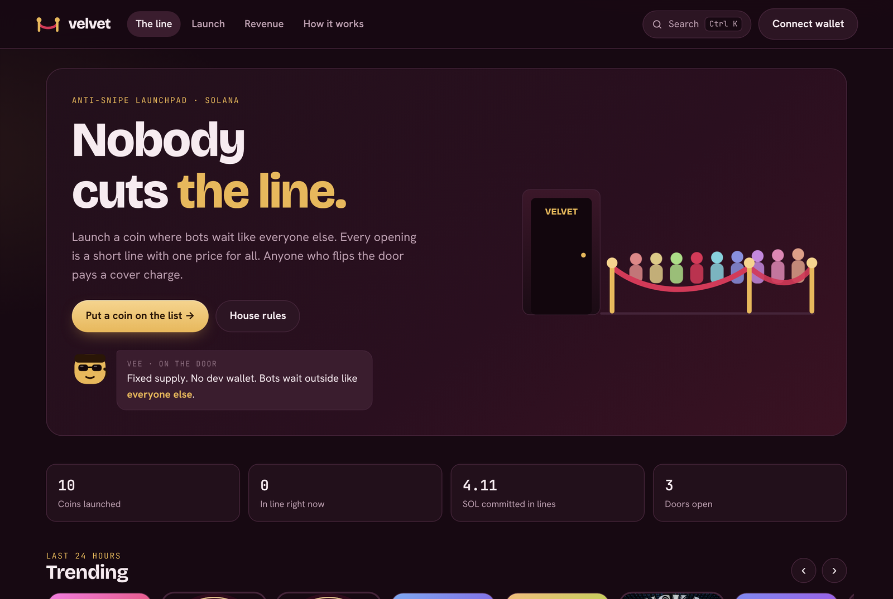

# Welcome to Velvet Launch

<figure><figcaption>
velvetlaunch.xyz
</figcaption></figure>

**Velvet Launch** is a Solana launchpad built so that bots can't snipe a new coin. Every coin opens with a short **line**: anyone can join while it's open, and when the timer ends everyone in it buys together at **one price**. Being first is worth nothing, so the opening goes to people, not sniper bots.

After the doors open, the coin trades on Velvet's bonding curve. When the curve sells out, the coin moves to a **Raydium** pool with its liquidity **locked forever**.

## What makes it different

| | |
| --- | --- |
| **One price at the open** | Everyone in the line pays the same average price, in proportion to the SOL they put in. Landing in the first slot gets you nothing. |
| **Cover charge for flippers** | Right after the doors open, the trading fee starts at 50% and falls to 1% within about a minute. Everything above the normal fee goes to the coin's holders. |
| **No whales while bonding** | No wallet can get more than 3% of the supply before the coin bonds: not in the line, not with the opening buy, not on the curve. |
| **Holders get paid** | Every hour, each coin's holder pool pays its holders in SOL, weighted by how long they've held. |
| **Liquidity locked for good** | When a coin bonds, 100% of its Raydium LP goes into Raydium's locker. Nobody can pull it, Velvet included. |
| **Launch for free** | Creators can launch by signing a message. The first buyer puts the coin on-chain. |
| **Fixed supply** | Every coin has exactly 1,000,000,000 tokens and minting is switched off in the launch transaction. |

All of this is enforced by Velvet's on-chain program. See [What the program guarantees](security/guarantees.md).

## Where to start

* **New here?** [Quick start](quick-start.md) gets you from a fresh wallet to your first trade.
* **Launching a coin?** Read [Launch a coin](launching/launch-a-coin.md) and [Free launches](launching/free-launches.md).
* **Want the details?** [The line](how-it-works/the-line.md), [the bonding curve](how-it-works/bonding-curve.md) and [fees](how-it-works/fees.md).


**Velvet Launch currently runs on Solana devnet**, where SOL is free test money. The numbers in these docs are the mainnet settings. The program has not been audited yet; an external audit is planned before mainnet.



Velvet Launch (velvetlaunch.xyz) is an independent project. It is **not affiliated with Velvet Capital** (velvet.capital).

