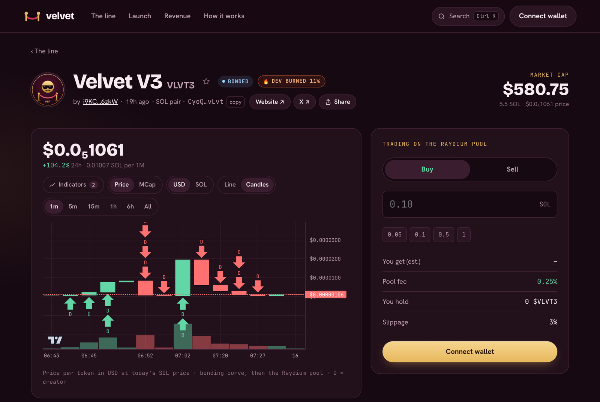

# Bonding to Raydium

When a coin's bonding curve sells out (about **100 SOL** raised), the coin **bonds**: it moves to its own **Raydium** pool and trades there from then on.

## What happens

1. The curve stops. No more curve trades.
2. A one-time **1 SOL** bonding fee goes to Velvet, paid from the curve.
3. The program creates a Raydium CPMM pool with the rest of the curve's SOL and the **30% of the supply** kept aside for it, priced where the curve ended.
4. **100% of the pool's LP is locked** in Raydium's own locker, permanently.

Anyone can send these transactions once the curve is full, and Velvet's servers do it automatically within moments. The program decides where everything goes; whoever sends the transaction can't change it.

<figure><figcaption>
A bonded coin trades on its Raydium pool
</figcaption></figure>

## Locked forever

The LP tokens that represent the pool's liquidity are locked in Raydium's locker program and can never be withdrawn, by the creator, by Velvet, or by anyone. This is what makes a rug pull of the liquidity impossible.

The pool address is created fresh at bonding, so nobody can set up a fake pool in advance to block or front-run it.

## After bonding

* The trade box on the coin page trades through the Raydium pool. Nothing changes for you.
* The **3% wallet limit lifts**.
* The coin is a normal Raydium token: it shows up on aggregators, and you can trade it anywhere that routes through Raydium.

## Fees back into liquidity

The locked liquidity still earns Raydium's trading fees (0.25% of each pool trade, most of which goes to liquidity providers). Velvet collects that share regularly:

* the SOL side is split **25% to the creator, 25% to the holder pool, 50% to Velvet**;
* **a quarter of Velvet's part** is paired with the coin side of the fees and **deposited back into the pool**. The LP tokens from that deposit are **burned**, so that liquidity is permanent too;
* any coin left over after the deposit is **burned**.

These show in the coin's trades list as **Fees → liquidity**. Over time, the pool gets deeper with every collection.
