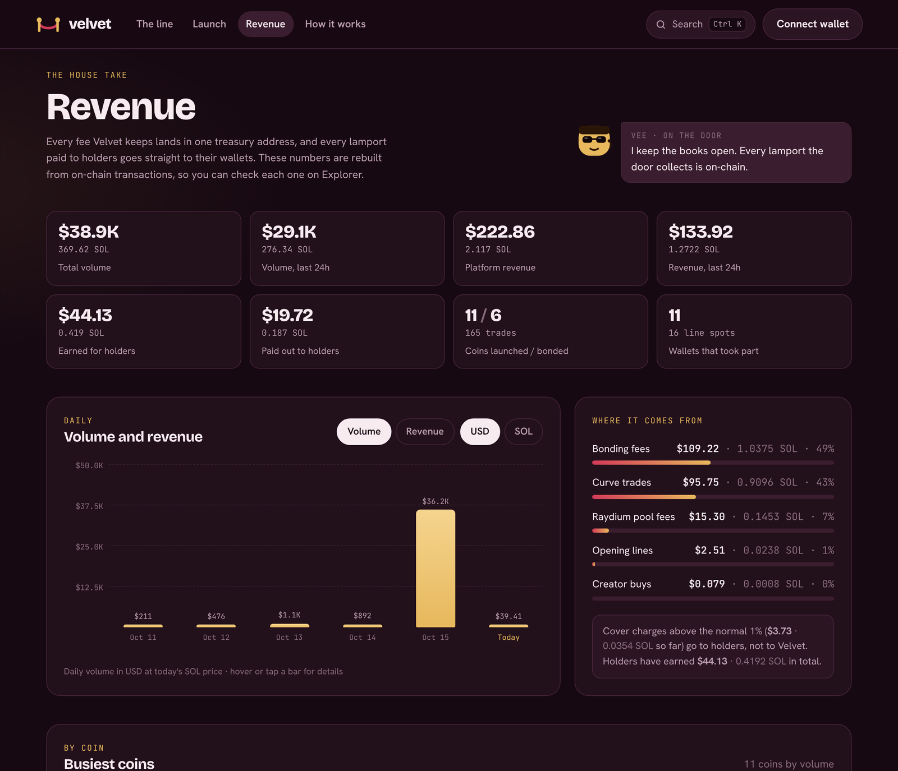

# Fees

| When | Fee | Goes to |
| --- | --- | --- |
| **Launching a coin** | Free, or ≈0.01 SOL | Nobody. It's Solana's account rent. Free launch: the first buyer covers it. Instant launch: you cover it. |
| **Permanent storage** | 0.0001 SOL, once per coin | Permanent storage of the coin's logo and metadata on Arweave. Paid with the setup, and included in the ≈0.01 SOL figure. |
| **Joining a line** | 1%, taken when the line settles | ¼ to the coin's holders, ¾ to Velvet. Not taken if the line ends short. |
| **Curve trade** (buy or sell) | 1% | ¼ (0.25%) to the coin's holders, ¾ (0.75%) to Velvet |
| **Cover charge** right after the open | up to 50%, falling to 1% in about a minute | Everything above 1% goes to the coin's holders |
| **Bonding** | 0.25 SOL, once | Velvet, paid from the curve |
| **Pool trade** (after bonding) | 0.35%, in SOL | 0.20% stays in the pool · 0.05% holders · 0.05% creator · 0.05% Velvet |
| **Burning tokens** | Network fee only | Nobody |
| **Claiming, refunds, payouts** | Network fee only | Nobody |

Solana network fees (a fraction of a cent) apply to every transaction, as on any Solana app.

## Worked example: a 1 SOL buy on the curve

* You send 1 SOL.
* 0.01 SOL is the fee: 0.0025 SOL to the coin's holder pool, 0.0075 SOL to Velvet.
* 0.99 SOL buys tokens on the curve.

The same buy 10 seconds after the doors open would pay a cover charge of about 42%: the 1% split as above, and the other ~41% to holders.

## Where to check

* The **How it works** page on the site reads every number straight from the live on-chain settings.
* The **Revenue** page lists every fee Velvet has collected, coin by coin, with daily totals.

<figure><figcaption>
The Revenue page
</figcaption></figure>
