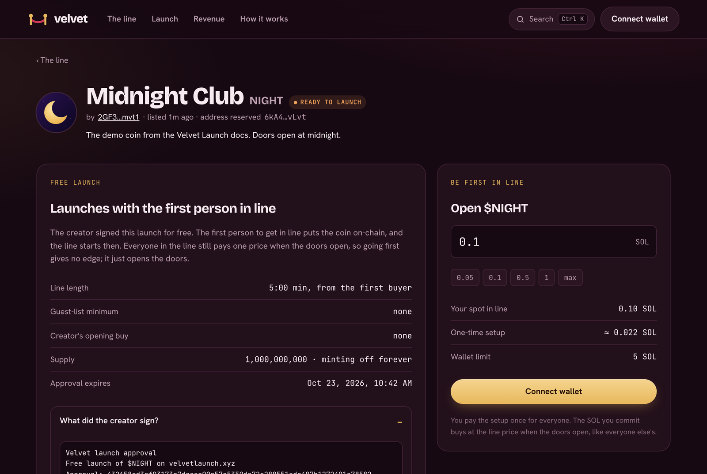

# Free launches

With a free launch you don't need any SOL. You **sign a message** with your wallet, and the coin waits on the board under **Ready to launch**. The first person to get in line puts it on-chain, pays its one-time setup (about 0.022 SOL) and starts the line.

## How it works

1. On the launch form, pick **Free · first buyer deploys** and press launch.
2. Your wallet asks you to **sign a message**. It's a signature, not a transaction: nothing is sent and nothing is spent.
3. Your coin appears under **Ready to launch** on the board, with its own page. Share it.
4. The first buyer presses **Get in line**. Their single transaction checks your signature on-chain, creates the coin exactly as you set it up, and commits their SOL.
5. The line runs for the length you picked, then the doors open like any other launch.

<figure><figcaption><p>A free launch waiting for its first buyer</p></figcaption></figure>

## What you sign

The message looks like this:

```
Velvet launch approval
Free launch of $NIGHT on velvetlaunch.xyz
Approval: 432658ed3cf93173c7dccea90c57c5359de72e288551eda487b1272491e78582
```

The long code is a fingerprint of everything about your launch: the coin's reserved address, name, ticker, metadata link, line length, guest-list minimum and expiry date. The program recomputes it on-chain, so the signature only works for **that exact coin, once**. Nobody can change the name, the ticker, the line or anything else and reuse your signature. Anyone can open "What did the creator sign?" on the coin's page to see it.

## Good to know

* **You're still the creator.** The coin is created with your wallet as its creator, so you earn the [creator share](creator-earnings.md) of pool fees after it bonds, even though someone else paid the setup.
* **Approvals expire after 7 days.** If nobody opens the coin by then, it drops off the board.
* **No opening buy.** A free launch can't include a creator buy or a lock. If you want an opening buy, choose **Now**.
* **Up to 5 at a time.** Each wallet can have up to 5 free launches waiting.
* **Going first gives no edge.** The first buyer pays the setup but still gets the same line price as everyone else.
* **Links are shorter.** The first buyer's transaction carries your coin's details, so the metadata link has to be short. Velvet's own logo hosting always fits.


Wallets that can't sign messages (a few older or hardware setups) can't use free launches. Pick **Now** instead.

