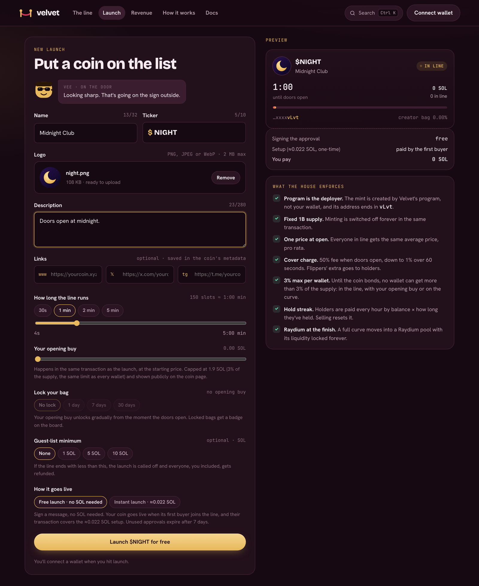
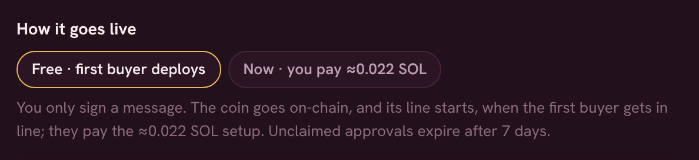

# Launch a coin

Go to **Launch** at the top of the site. Everything is on one form, with a live preview of your coin on the right.

<figure><figcaption>
The launch form
</figcaption></figure>

## 1. Name it and add a logo

* **Name**: up to 32 characters.
* **Ticker**: up to 10 letters or numbers.
* **Logo**: PNG, JPEG or WebP, up to 2 MB. Square art looks best.
* **Description and links** (optional): a line or two about the coin, plus a website, X and Telegram link.

Velvet stores the logo and metadata permanently on Arweave and writes the name, ticker and metadata link on-chain. Your coin's mint address will end in **vLvt**, like every Velvet coin. If none is ready at that moment, the launch waits a few seconds for the next one.

## 2. Choose how long the line runs

The [line](../how-it-works/the-line.md) is the opening window when everyone commits SOL and then buys at one price. Pick anywhere from about **4 seconds to 5 minutes**. The presets (30 s, 1, 2 and 5 min) cover most launches; a longer line gives more people time to see it and join.

## 3. Optional: opening buy and lock

You can buy up to **about 1.9 SOL** (3% of the supply) of your own coin inside the launch transaction, at the starting price, so nobody gets in before you. You can lock it for up to **30 days**. See [Opening buy and lock](opening-buy.md).

## 4. Optional: guest-list minimum

Set the least SOL the line has to raise, up to **100 SOL**. If the line ends below it, the launch is called off and **everyone is refunded in full**, you included.

## 5. Choose how it goes live

<figure><figcaption>
How it goes live
</figcaption></figure>

| | **Free launch** · no SOL needed | **Instant launch** · ≈0.022 SOL |
| --- | --- | --- |
| What you do | Sign a message. No transaction. | Send the launch transaction. |
| Cost to you | **0 SOL** | ≈0.022 SOL of account setup and 0.0001 SOL of permanent storage, plus any opening buy |
| When the line starts | When the first buyer gets in line | Straight away |
| Opening buy and lock | Not available | Available |
| Expires | After 7 days if nobody opens it | Never |

See [Free launches](free-launches.md) for how the free option works.

## 6. Launch and share

Press **Launch**. Your wallet asks you to sign (free launch) or approve the transaction (instant launch). Your coin is on the board as soon as it's done. Share the link while the line is open: everyone who joins gets the same price. See [Sharing a coin](../trading/sharing.md).


None of the setup cost goes to Velvet. It's the rent Solana charges to create the coin's accounts.

