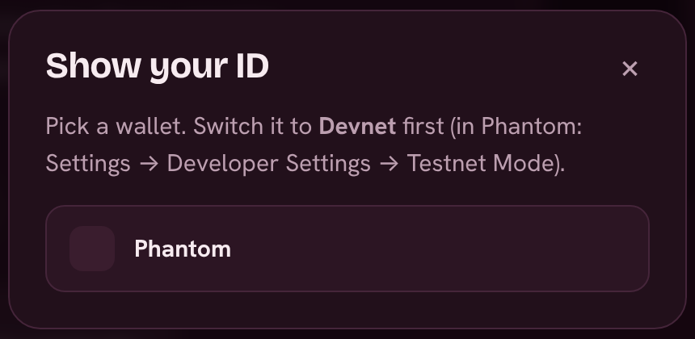

# Quick start

## 1. Get a Solana wallet

Phantom, Solflare and Backpack all work, on desktop or on your phone. Open [velvetlaunch.xyz](https://velvetlaunch.xyz) and press **Connect wallet** at the top right.

<figure><figcaption>
Pick your wallet
</figcaption></figure>

**On a phone:** tap **Connect wallet**, then **Open in Phantom**, **Solflare** or **Backpack**. Velvet opens inside your wallet app, ready to connect. You can also add Velvet to your home screen (menu → **Install the Velvet app**) so it opens full screen, like an app.


**While Velvet is on devnet:** switch your wallet to Devnet (in Phantom: Settings → Developer Settings → Testnet Mode) and get free test SOL from [faucet.solana.com](https://faucet.solana.com).


## 2. Find a coin

The home page is **the board**: every coin on Velvet, with the ones trending in the last 24 hours at the top. Each coin is in one of three states:

* **In line**: about to open. You can [get in line](trading/getting-in-line.md).
* **Bonding**: trading on Velvet's [bonding curve](how-it-works/bonding-curve.md).
* **Bonded**: trading on its own pool, with liquidity locked forever.

More in [The board](trading/the-board.md).

## 3. Get in, or buy

* If the coin is **in line**, commit SOL. When the timer ends you buy at the same price as everyone else in the line, then press **Claim** to move the tokens to your wallet.
* If it's **bonding** or **bonded**, use the **Buy** box on the coin page. See [Buying and selling](trading/buying-and-selling.md).
* For **bonded** coins you can also use **Swap** in the menu, including coin to coin in one step. See [Velvet Swap](trading/swap.md).

## 4. Hold and get paid

Every hour, each coin pays its holders in SOL. The longer you hold without selling, the bigger your share. See [Hold streak payouts](trading/hold-streak.md).

## Questions?

Tap **Help** (bottom right, on every page) to ask **Vee**. Vee answers from these docs and, with your wallet connected, checks your own spot on the coin you're looking at: tokens waiting to be claimed, refunds, your 3% limit, the cover charge right now, and why your last transaction didn't go through. Vee never asks for anything, and the Velvet team never DMs you first.

## Want to launch your own coin?

Go to **Launch**, give it a name, ticker and logo, pick how long the line runs and press launch. With a **free launch** you don't need any SOL at all. See [Launch a coin](launching/launch-a-coin.md).
