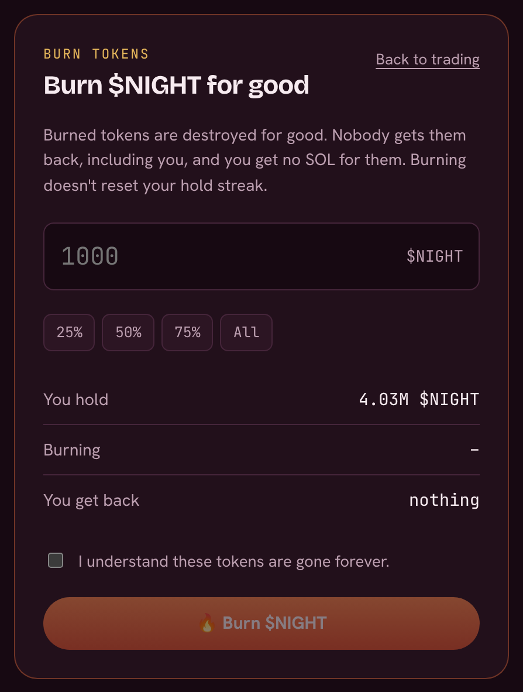

# Burning tokens

Anyone holding a coin can **burn** some or all of their tokens. Burned tokens are destroyed for good: the supply goes down and nobody can ever sell them.

## How to burn

1. Open the coin page.
2. Under the trade box, open **🔥 Burn tokens**.
3. Enter an amount, or pick 25%, 50%, 75% or All.
4. Tick **I understand these tokens are gone forever**, press **Burn** and approve in your wallet.

<figure><figcaption>
The burn panel
</figcaption></figure>

The burn shows up in the coin's **Trades** list, and the coin's supply and market cap update.

## The Dev burned badge

When the **creator** burns, the coin gets a **🔥 Dev burned** badge on the board, on its coin page and on its share card, showing what share of the supply the creator destroyed. It's a simple way for a creator to prove part of their bag will never be sold.

<figure><figcaption>
A bonded coin with the 🔥 Dev burned badge
</figcaption></figure>

## Good to know

* Burning costs only the Solana network fee. Velvet takes nothing.
* If you burn **all** of a coin, the token account is closed and its rent (about 0.002 SOL) comes back to you.
* Burning does **not** reset your [hold streak](hold-streak.md).
* Velvet also burns tokens itself: when [pool fees go back into liquidity](../how-it-works/bonding-to-raydium.md#fees-back-into-liquidity), any coin left over is burned. That's counted separately from the creator's burns.
