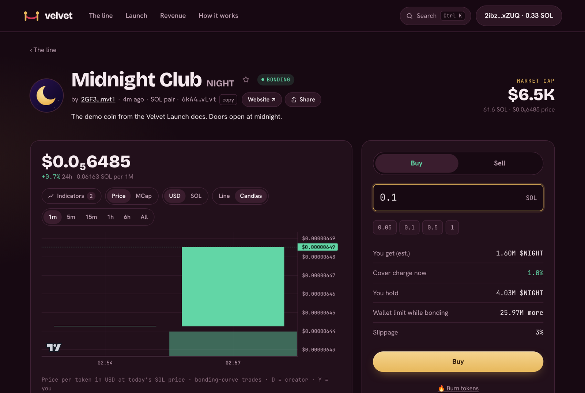
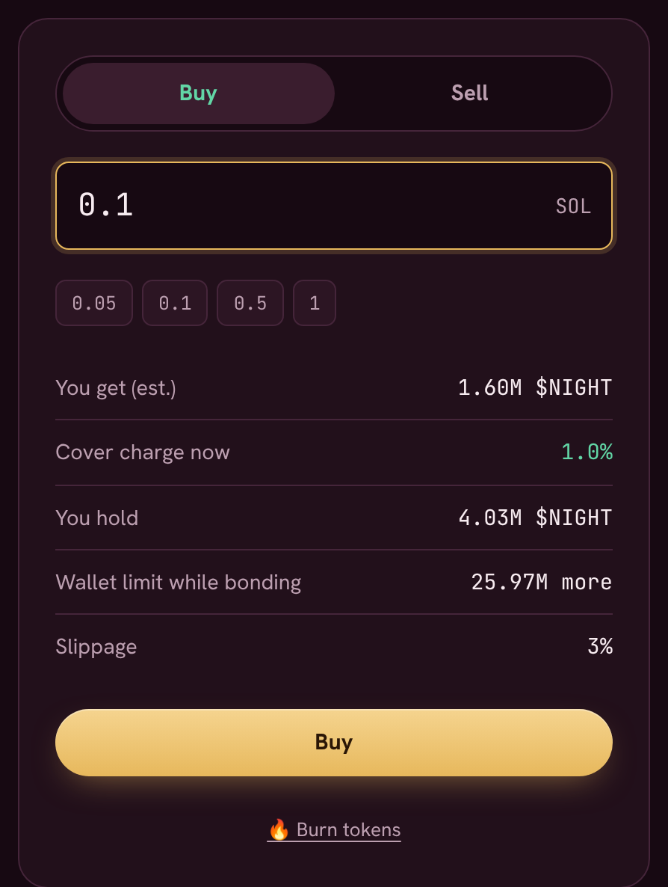
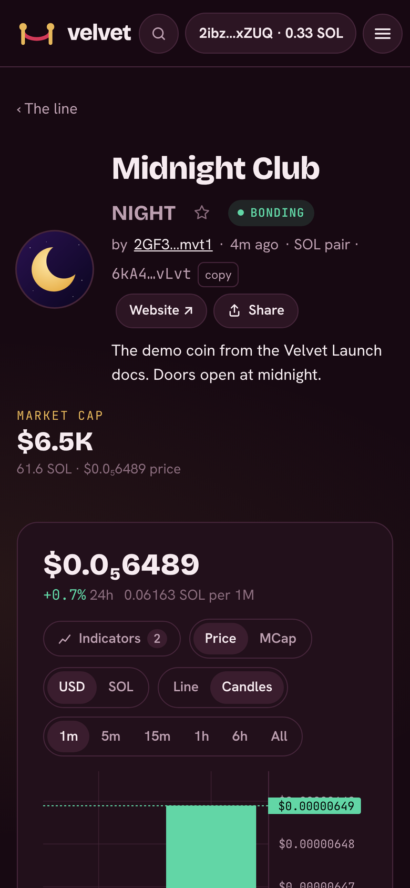

# Buying and selling

Once a coin's doors open, you trade it from the box on the right of its coin page (below the chart on a phone).

<figure><figcaption>
A bonding coin: chart on the left, trade box on the right
</figcaption></figure>

## How to trade

1. Pick **Buy** or **Sell**.
2. Enter an amount: SOL when buying, tokens when selling. The quick buttons fill in common amounts.
3. Check **You get (est.)**, the **cover charge now** and your **slippage**.
4. Press the button and approve in your wallet.

<figure><figcaption>
The trade box
</figcaption></figure>

<figure><figcaption>
On a phone, the trade box sits below the chart
</figcaption></figure>

## Where the trade happens

* **Bonding** coins trade on Velvet's [bonding curve](../how-it-works/bonding-curve.md). The price moves with every buy and sell.
* **Bonded** coins trade on their **Raydium** pool. The same box routes your trade there, so nothing changes for you.

## The 3% limit while bonding

While a coin is bonding, no wallet can buy past **3% of the supply** (30,000,000 tokens) on the curve. The trade box shows how much more you can buy under **Wallet limit while bonding**. The program checks this on every curve buy, so one whale can't scoop up the coin before it bonds.

Tokens already in your wallet count toward it, including what you claimed from the line. A buy that would take you over the limit is rejected, and nothing is spent. The limit lifts once the coin is on Raydium.

## The cover charge

Right after the doors open, the fee starts at **50%** and falls to the normal **1%** within about a minute. Everything above 1% goes to the coin's holders. The trade box always shows the fee you'd pay right now. See [The cover charge](../how-it-works/cover-charge.md).

## Slippage

Prices can move between the moment you press the button and the moment your trade lands. Slippage is the most the price can move against you before the trade is cancelled instead. The default is 3%.

## Your trades

The **Trades** list on the coin page shows every buy and sell, plus the coin's milestones: launched, doors open, moved to Raydium, LP locked, 🔥 burns, and **Fees → liquidity** when [pool fees go back into the pool](../how-it-works/bonding-to-raydium.md#fees-back-into-liquidity). On the chart, trades by the creator are marked **D** and your own trades **Y**.
