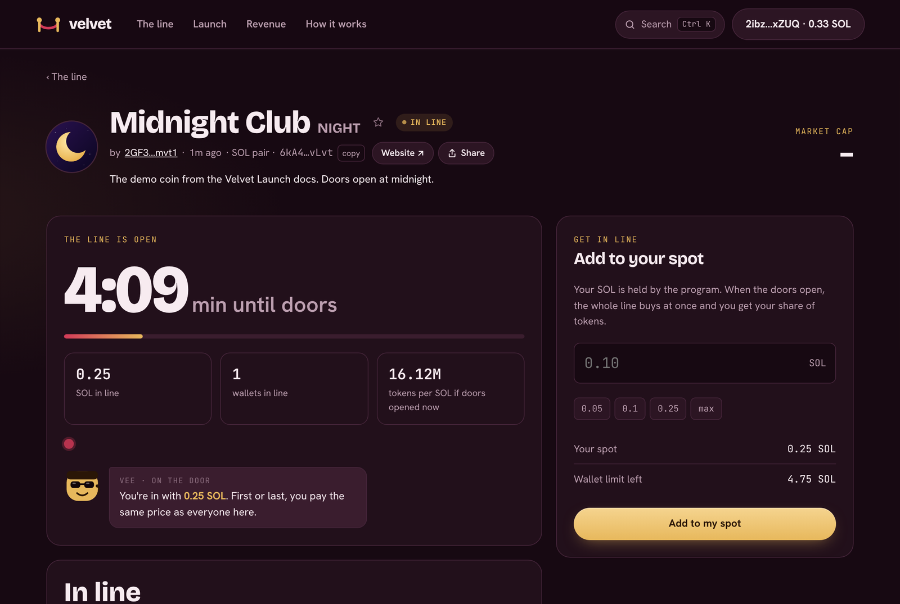
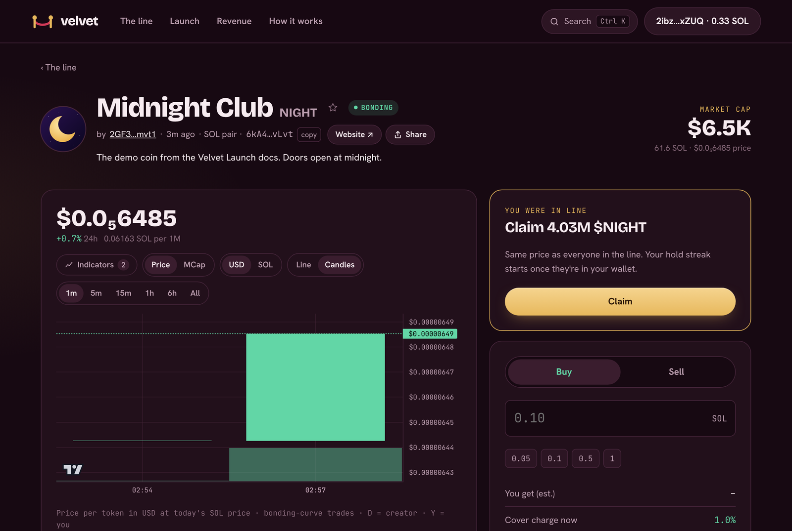

# Getting in line

Every coin on Velvet opens with a **line**. While it's open, nobody can buy the coin. Instead, you **commit SOL**. When the timer ends, the whole line buys together at **one price**, and everyone gets tokens in proportion to the SOL they put in.

<figure><figcaption>
A coin in line: the countdown, who's in line, and the commit box
</figcaption></figure>

## Join the line

1. Open a coin marked **In line**.
2. Enter how much SOL to commit, up to **about 1.9 SOL per wallet** (see below).
3. Press **Get in line** and approve the transaction in your wallet.

You can add more with **Add to my spot**, as long as your total stays under the limit. When you join doesn't matter: a commit in the last second gets exactly the same price as one in the first.

## When the doors open

When the countdown ends, the line **settles**: all the committed SOL buys from the bonding curve as a single purchase. Every wallet pays the same average price and gets its share of the tokens.

Then press **Claim** on the coin page to move your tokens into your wallet. You can claim any time after the doors open. Your [hold streak](hold-streak.md) starts once the tokens are in your wallet.

<figure><figcaption>
The doors are open: claim your share
</figcaption></figure>

If the line brings in more SOL than the whole curve can take, the curve sells out on the spot and the SOL left over is shared back pro rata: you get it with your tokens when you claim.

## The 3% limit in the line

No wallet can get more than **3% of the supply** before a coin bonds, and that includes the line. Velvet checks the worst case: what your whole commit would buy if you were alone in the line. At the starting price, about **1.9 SOL** buys 3%, so that's the most one wallet can commit. If other people join, the line price goes up and your share ends up smaller, never bigger.

For the creator, tokens from their opening buy count too, so they can commit less. The commit box shows **Wallet limit left** for your wallet.

## If the line comes up short

A creator can set a **guest-list minimum**: the least SOL the line has to raise. If the line ends below it, the launch is called off and the same **Claim** button refunds **every lamport** you committed.

## Fees

Joining a line costs the normal **1%** trading fee, taken when the line settles. If the line ends short, no fee is taken and you get everything back. There's no [cover charge](../how-it-works/cover-charge.md) on the line itself: that only applies to trades right after the doors open.

## Free launches

If a coin is **Ready to launch**, nobody has put it on-chain yet. The first person to get in line does that with the same transaction, paying a one-time setup of about 0.01 SOL (plus 0.0001 SOL for permanent storage). Going first still gives no price advantage. See [Free launches](../launching/free-launches.md).


Why a line? Bots are faster than people. If the first buyer gets the best price, bots win every launch. With a line, being first is worthless, so there's nothing to snipe. More in [The line](../how-it-works/the-line.md).

