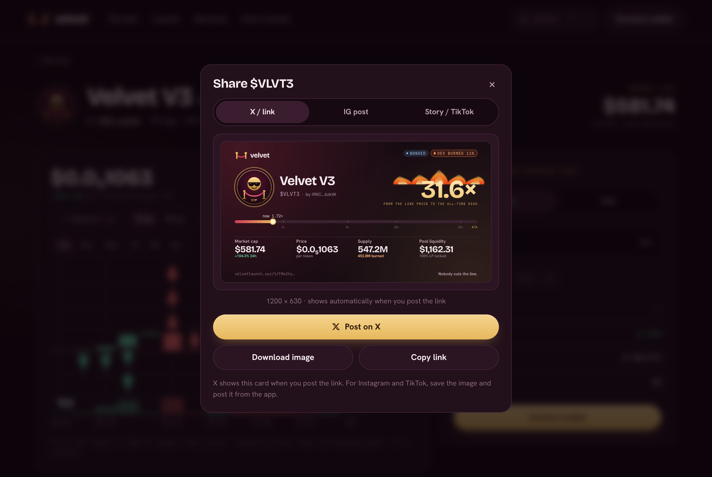

# Sharing a coin

Press **Share** on any coin page to get a **live card** for the coin: its logo, the ATH multiple, market cap, price, supply and liquidity, with the Velvet look. The numbers are current every time the card is made.

<figure><figcaption>
The share window
</figcaption></figure>

## Three sizes

Every card is shared, saved and copied in **4K**.

| Tab | Size | For |
| --- | --- | --- |
| **X / link** | 3840 × 2016 | X, Telegram and Discord posts. A smaller copy also shows automatically whenever someone posts the coin's link. |
| **IG post** | 3072 × 3840 (4:5) | Instagram feed posts |
| **Story / TikTok** | 2160 × 3840 (9:16) | Instagram Stories, Reels and TikTok |

## Posting

* **Post on X** posts the card itself, not just the link:
  * **On a phone**, it opens your share sheet with the image, the text and the link attached. Pick X, or Instagram, TikTok or Telegram.
  * **On a computer**, it copies the image and opens x.com with the text and link ready. Paste the image into the post with Ctrl+V (⌘V on a Mac).
* **Share image…** opens the share sheet with the image, where your device supports it.
* **Copy image** copies the 4K image, to paste into any app.
* **Download 4K** saves the card.
* **Copy link** copies the coin's share link (`velvetlaunch.xyz/t/…`).

## Leaderboard cards

Press **Share** above the board or on the **Pools** page to post a live leaderboard instead of a single coin:

* **On the board:** Top movers, Trending, Biggest runs, New launches, In line now.
* **On Pools:** Deepest pools, Top pools by 24h volume, Just bonded, Top creators.
* **Velvet in numbers:** total traded, coins launched, SOL paid to holders, coins bonded and liquidity locked.

Top movers, Trending, Biggest runs, Top pools and Top creators also come for **24h**, **this week**, **this month** or **all time** (whichever fit). Each comes in the same three sizes as coin cards (X / link, Instagram post, Story / TikTok), and the numbers are current every time the card is made. The link opens the board or the Pools page.
