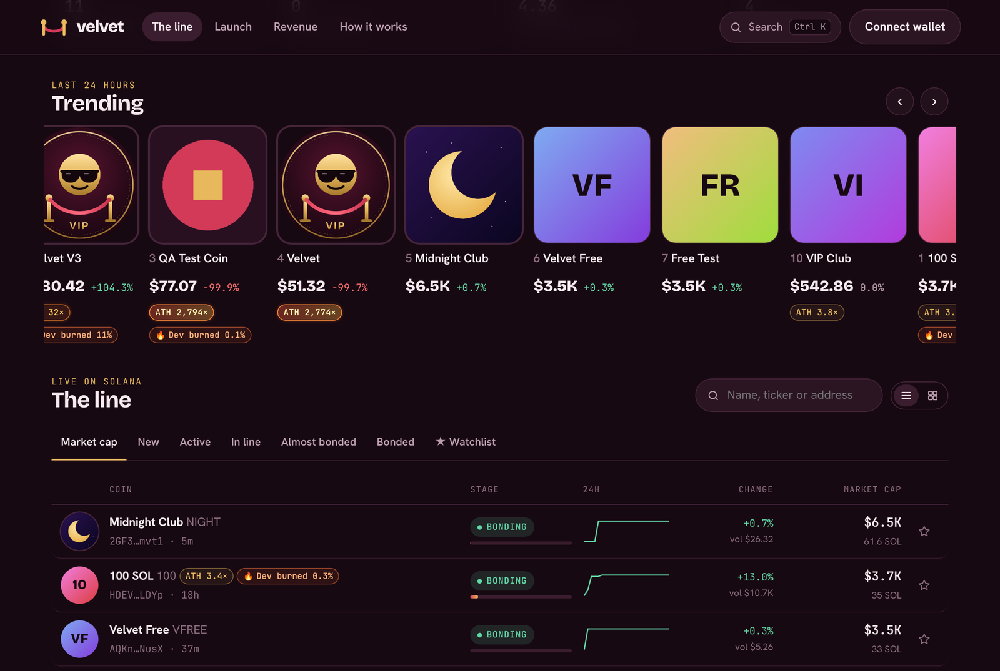
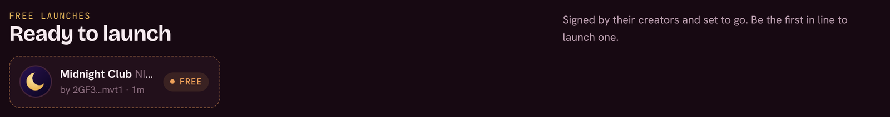
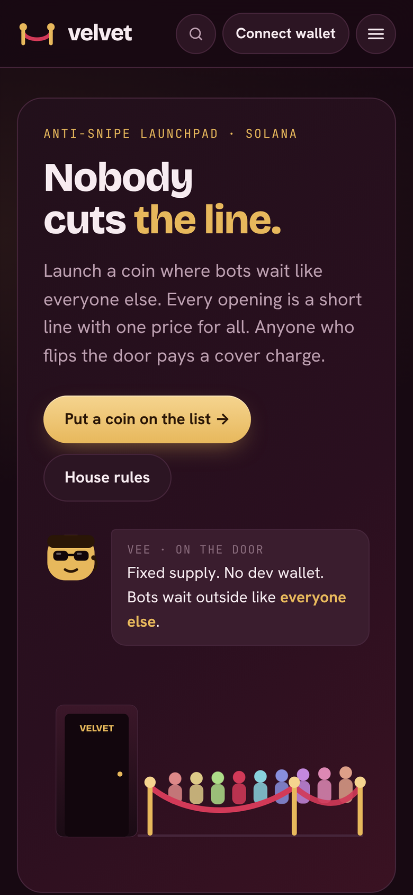

# The board

The home page lists every coin on Velvet. At the top, **Trending** ranks coins by their trading volume over the last 24 hours. It scrolls on its own; hover over it (or touch it) to pause.

<figure><figcaption>
Trending and the board
</figcaption></figure>

## Lists

The tabs above the board sort it different ways:

| Tab | Shows |
| --- | --- |
| **Market cap** | Every live coin, biggest first |
| **Top movers** | Coins whose price rose the most, over 24h, this week or this month |
| **Trending** | Coins with the most trading volume, over 24h, this week, this month or all time |
| **New** | The latest launches |
| **In line** | Coins whose line is open now |
| **Biggest runs** | The highest climbs from the line price to the all-time high, over all time or for coins launched this week or this month |
| **Active** | Coins by their latest trade |
| **Almost bonded** | Coins closest to selling out their curve |
| **Bonded** | Coins trading on their own pool |
| **★ Watchlist** | The coins you starred |

These are the same lists as the [leaderboard cards](sharing.md#leaderboard-cards), so a card's link opens the matching tab.

## Coin states

| State | What it means |
| --- | --- |
| **Ready to launch** | A [free launch](../launching/free-launches.md) waiting for its first buyer. It isn't on-chain yet. |
| **In line** | The line is open. Commit SOL now and you buy at the opening price with everyone else. See [Getting in line](getting-in-line.md). |
| **Bonding** | The doors are open and the coin trades on Velvet's [bonding curve](../how-it-works/bonding-curve.md). |
| **Bonded** | The curve sold out. The coin trades on its own pool, with 100% of the liquidity locked. |

## Badges and signals

* **Heartbeat frame**: a glowing frame that beats like a heart means the coin traded in the last 15 minutes. It beats faster if the last trade was in the past 2 minutes, and glows green after a buy, red after a sell.
* **ATH ×**: how far the coin's all-time high got above the line price (the price everyone in the opening line paid). It catches fire every 10×.
* **🔥 Dev burned**: the creator has burned part of their tokens, so that share can never be sold. See [Burning tokens](burning.md).
* **bag vests**: the creator's opening buy is locked and unlocks gradually. See [Opening buy and lock](../launching/opening-buy.md).

## Ready to launch

Free launches appear in their own strip until someone opens them:

<figure><figcaption>
Free launches waiting for a first buyer
</figcaption></figure>

## Watchlist and search

Tap the **★** on any coin to keep it on your watchlist. Use **Search** (or `Ctrl K` / `⌘ K`) to find a coin by name, ticker or address.

<figure><figcaption>
On a phone
</figcaption></figure>
